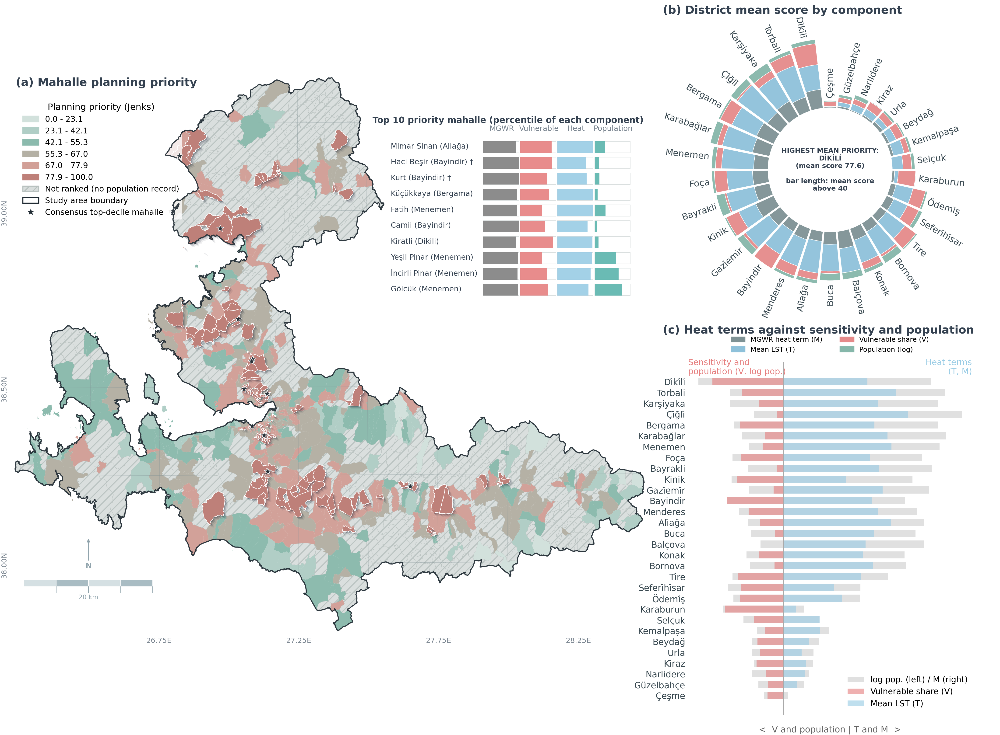
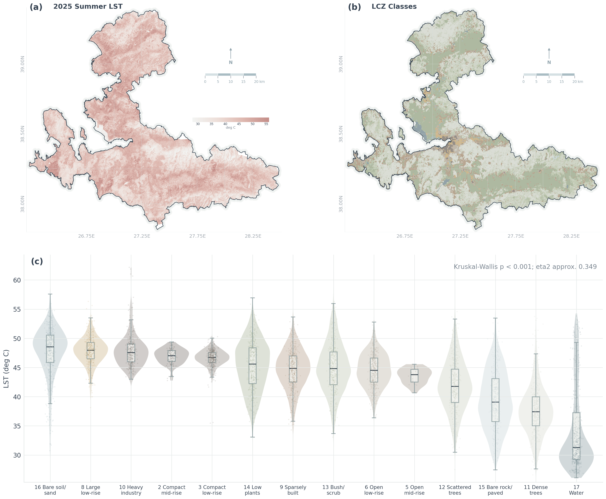
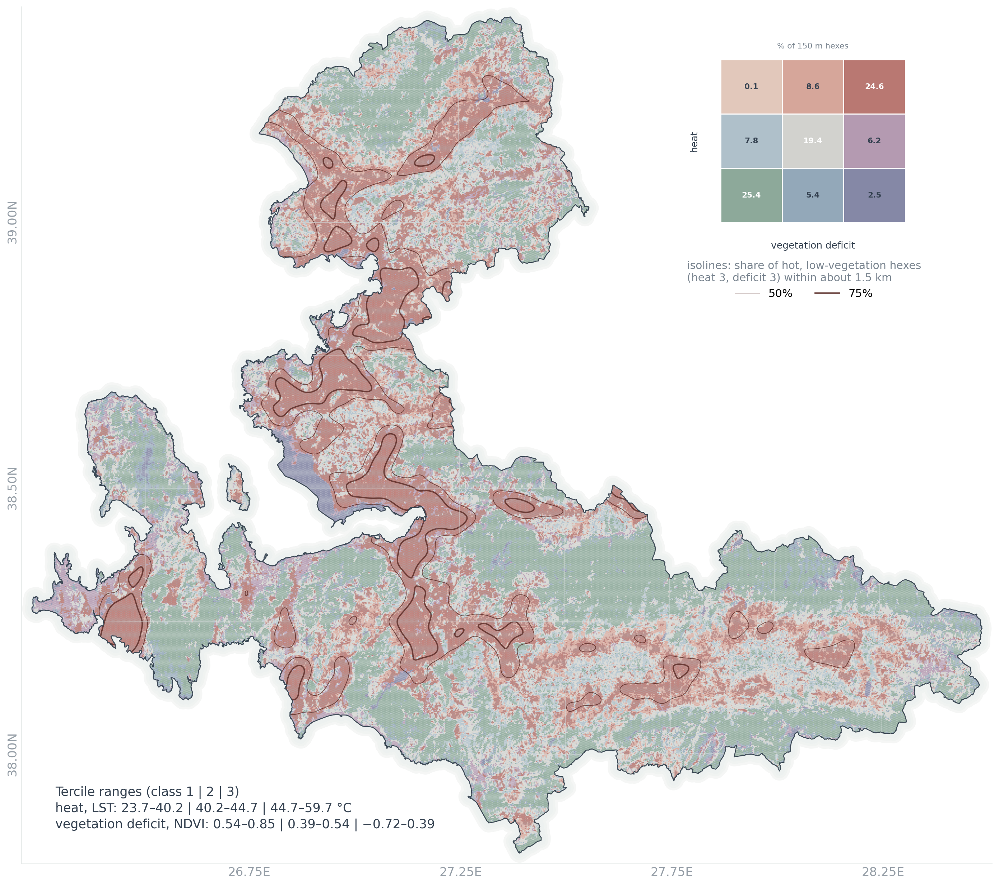
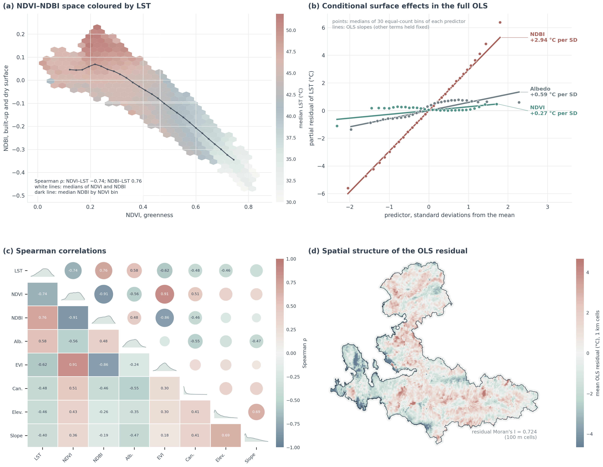
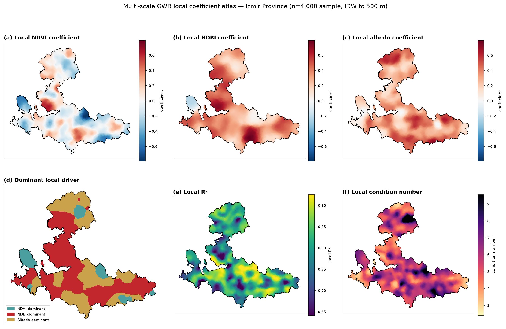
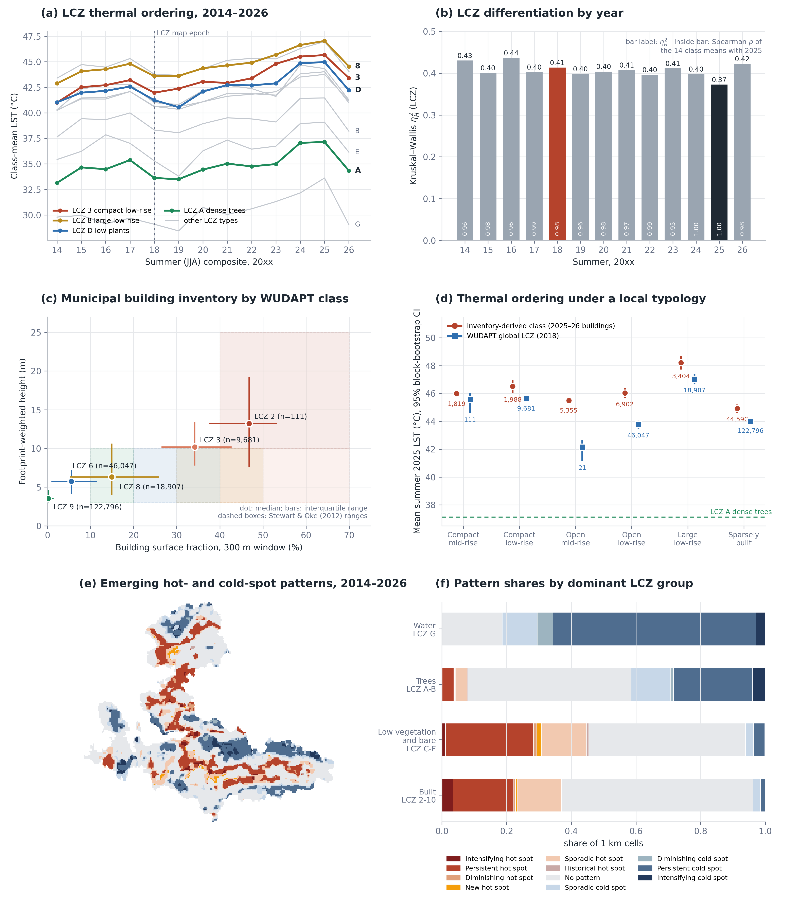
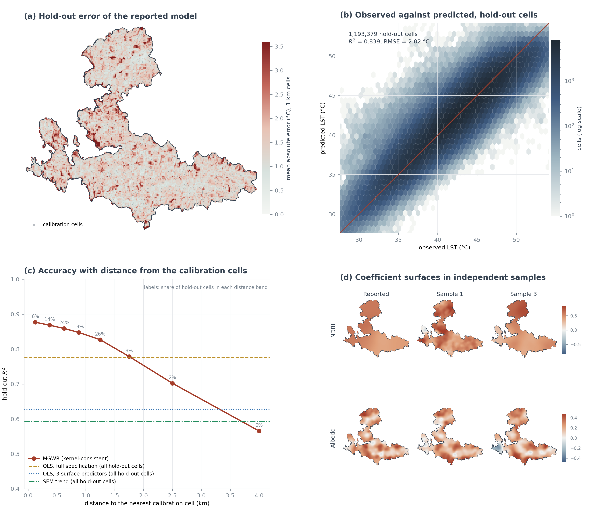
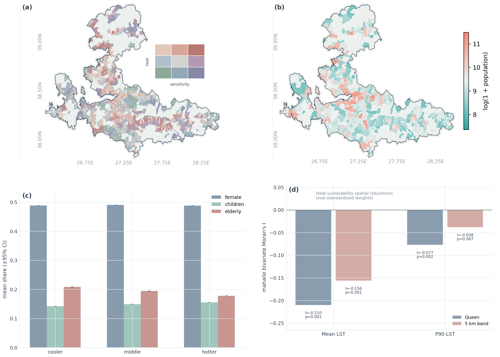

  

  
  
  
  
  

# Mapping urban heat exposure across local climate zones for heat-vulnerability planning

This is the open research companion to a study of how urban form, vegetation, and social vulnerability structure daytime summer heat exposure across Izmir, Turkiye. It connects a cloud-local Landsat data cube to Local Climate Zone (LCZ) morphology, tests global and multi-scale spatially varying regression models, and translates the evidence into neighbourhood-level heat-justice planning priorities.

> The manuscript is in revision (R1) at *Cities*. No article DOI has been assigned. Values below are those of the revised manuscript. This repository contains code, author-created figures, and compact parameter tables — not the manuscript, publisher PDF, or third-party geospatial data.

<table>
  <tr>
    <td align="center"><strong>15</strong> LCZ classes represented</td>
    <td align="center"><strong>&eta;&sup2; = 0.373</strong> LCZ thermal differentiation</td>
    <td align="center"><strong>R&sup2; = 0.839</strong> MGWR grid hold-out</td>
    <td align="center"><strong>I = &minus;0.079</strong> MGWR residual autocorrelation</td>
    <td align="center"><strong>1,197,430</strong> 100 m province grid cells</td>
  </tr>
</table>

  

## Why this repository matters

The scientific contribution is not another single-city heat map. It is the explicit coupling of LCZ-defined urban morphology, a cloud-local data cube that leaves no proprietary dependency, multi-scale spatially varying regression that isolates *where* each heat driver matters most, and an administratively legible mahalle-level priority surface that connects remote-sensing evidence to planning decisions.

- Fourteen WUDAPT LCZ types are mapped across Izmir Province. LCZ class explains &eta;&sup2; = 0.373 of 2025 summer daytime LST variance, and compact LCZ 2&ndash;3 fabric is 8.51 &deg;C warmer than dense tree cover.
- The LCZ thermal ordering is nearly the same in all thirteen summers of the 2014&ndash;2026 Landsat cube (Kendall's *W* = 0.970); 2025 is the second warmest of these summers.
- A global OLS benchmark explains 78.2% of LST variance but leaves strongly autocorrelated residuals (Moran's *I* = 0.724).
- MGWR on a 4,000-cell calibration sample (bandwidths: intercept 20, NDVI 89, NDBI 1,071, albedo 101 neighbours) fits *R*&sup2; = 0.900 with residual *I* = &minus;0.079 and predicts the 1,193,379 grid cells outside its sample with *R*&sup2; = 0.839. Under 10 km spatial block cross-validation it explains 0.737 of held-out variance against 0.616 for OLS with the same predictors, while a global OLS with terrain, canopy and LCZ controls reaches 0.791, so the local model is read as a descriptive rather than a transferable predictive tool.
- Across independent samples the built and dry-surface (NDBI) warming relationship is positive almost everywhere, whereas the vegetation relationship is weak and its local map is not reproducible across samples.
- Mahalle-level heat&ndash;vulnerability overlap is spatially mixed. A screening index combining observed heat, the MGWR-based surface-heat term, demographic sensitivity and population ranks the mahalle holding 97.3% of the provincial population; it is a hazard-led screening layer that has not been validated against heat-health outcomes.

## The analytical chain

~~~mermaid
flowchart LR
    A["Landsat 8/9 summer LST + spectral indices + albedo"] --> B["100 m cloud-local data cube"]
    C["WUDAPT LCZ"] --> D["LCZ thermal differentiation"]
    E["SRTM terrain + Meta TCH canopy"] --> F["OLS baseline + VIF diagnostics"]
    B --> F
    D --> G["Residual Moran spatial diagnostics"]
    F --> G
    G --> H{"MGWR multi-scale"}
    H --> I["Coefficient atlas bandwidth heterogeneity"]
    J["Population vulnerability mahalle administrative"] --> K["Bivariate Moran heat-vulnerability overlap"]
    I --> L["Mahalle heat-justice priority surface"]
    K --> L
~~~

Method details are documented in [docs/methods.md](docs/methods.md).

## Reproduce the workflow

The fastest local setup uses Conda/Mamba:

~~~bash
git clone https://github.com/YusufEminoglu/izmir-urban-heat-exposure.git
cd izmir-urban-heat-exposure
mamba env create -f environment.yml
mamba activate izmir-urban-heat-exposure
python scripts/validate_metadata.py
python scripts/publication_audit.py
~~~

For Earth Engine exports, copy `.env.example` to your own untracked environment configuration and set `EE_PROJECT` and `GEE_DRIVE_FOLDER`. Then follow the staged recipe in [docs/reproducibility.md](docs/reproducibility.md).

### Revision (R1) analyses

`r1/analysis/` holds the scripts of the revision: LCZ uncertainty and temporal consistency (2014&ndash;2026 cube), building-inventory validation, MGWR stability, hold-out and spatial cross-validation, model comparison, priority-index alternatives and the province-grid completion. Each script writes its numbers to `outputs/values/<script>.csv`; `common.py` sets the data paths. Earth Engine scripts read the project from the `EE_PROJECT` environment variable. `r1/mgwr_run/` is the MGWR fit. The processed analysis grid and model outputs these scripts read will be released with the article.

Third-party rasters are deliberately absent. [docs/data_sources.md](docs/data_sources.md) links each provider and records the redistribution boundary.

## Repository map

~~~text
izmir-urban-heat-exposure/
├── src/                    analysis, GEE export, figure, and table code
├── r1/                     revision (R1) analyses: every value of the revised manuscript
├── data/model_params/      versioned author-created model parameters
├── figures/png/            the eleven manuscript figures (order in figures/figure_order.csv)
├── scripts/                metadata validation and pre-publication audit
├── docs/                   methods, provenance, reproducibility, project site
├── CITATION.cff            software and preferred article citation metadata
├── .zenodo.json            archive-ready author and ORCID metadata
├── environment.yml         geospatial Conda environment
└── requirements.txt        pinned Python environment
~~~

## Visual atlas

| LCZ thermal differentiation | Bivariate heat&ndash;vegetation atlas |
|---|---|
|  |  |

| Baseline model diagnostics | MGWR coefficient atlas |
|---|---|
|  |  |

| LCZ evidence and temporal consistency | MGWR validation and stability |
|---|---|
|  |  |

| Heat-justice synthesis | Mahalle priority surface |
|---|---|
|  |  |

## Reproducibility boundary

This repository makes the analysis logic inspectable, but it cannot legally or responsibly mirror every provider raster. Reproduction therefore has two levels:

1. Code-level reproduction: environment, workflow order, parameters, and authored figures are complete here.
2. Data-level rerun: users obtain the listed datasets under their original terms, authenticate with their own Earth Engine account, and populate ignored staging directories.

The model parameter tables and coefficient summaries released here allow verification of the reported statistics without re-running the full pipeline.

## Related studies

- Eminoğlu, Y., Çelik, H.M. (2026). Diagnosing urban heat vulnerability through multiscale spatial modelling: Evidence from Istanbul for climate-resilient cities. *Sustainable Cities and Society*, 138, 107190. [doi:10.1016/j.scs.2026.107190](https://doi.org/10.1016/j.scs.2026.107190) — a neighbourhood heat-vulnerability index with supervised PCA weighting, MGWR and local clustering.
- Eminoğlu, Y., Çubukçu, K.M. (2026). Dual friction mapping of urban pedestrian spaces: Integrating street-view visual analytics and Geographically Neural Network Weighted Regression in Izmir, Türkiye. *Sustainable Cities and Society*, 150, 107913. [doi:10.1016/j.scs.2026.107913](https://doi.org/10.1016/j.scs.2026.107913) — street-level physical and thermal pedestrian friction in Izmir, the design-scale complement of the 100 m screening layers here.

## Authors

| Author | Affiliation | Profiles |
|---|---|---|
| **Yusuf Eminoglu** · corresponding author | Department of City and Regional Planning, Dokuz Eylul University |     |
| **Kemal Mert Cubukcu** | Department of City and Regional Planning, Dokuz Eylul University |    |

## Citation

Use the repository's "Cite this repository" control, powered by [CITATION.cff](CITATION.cff). Until the article is accepted, please treat the preferred article metadata as "under review" and do not invent a DOI.

## Licence and attribution

Code is MIT licensed. Documentation and author-generated figures are CC BY 4.0. Input datasets retain their providers' terms and are not redistributed. See [NOTICE.md](NOTICE.md) and [docs/data_sources.md](docs/data_sources.md).

Created by Yusuf Eminoglu and Kemal Mert Cubukcu at Dokuz Eylul University, Department of City and Regional Planning, Izmir, Turkiye.
